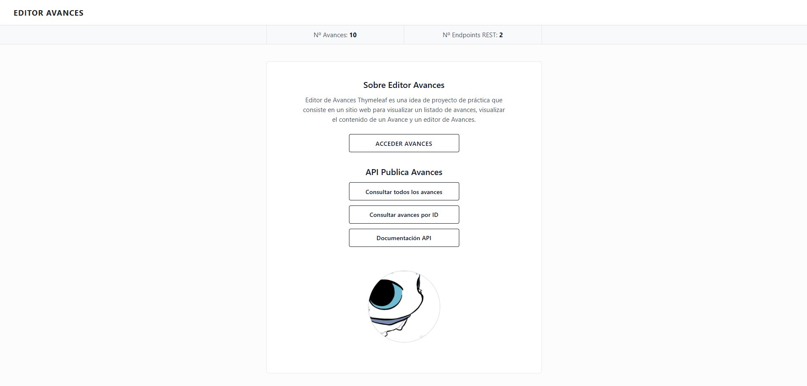
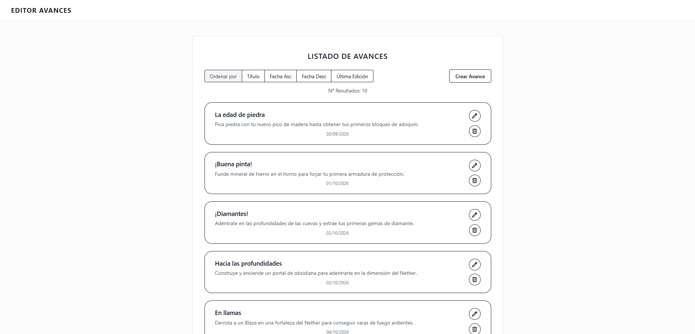
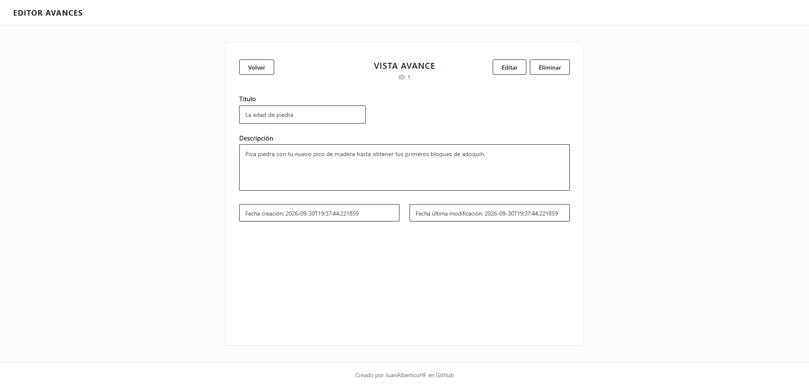
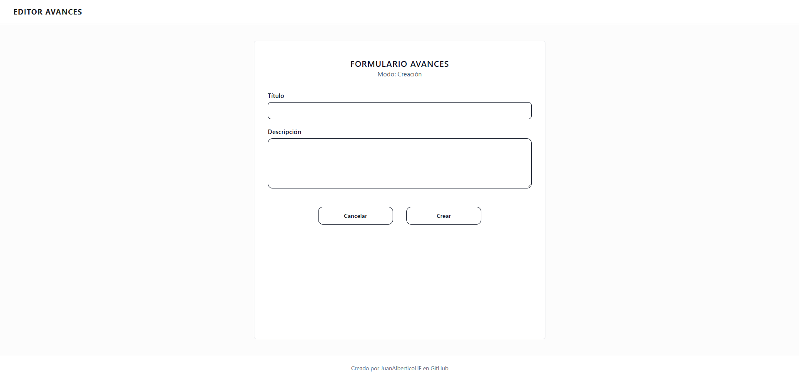
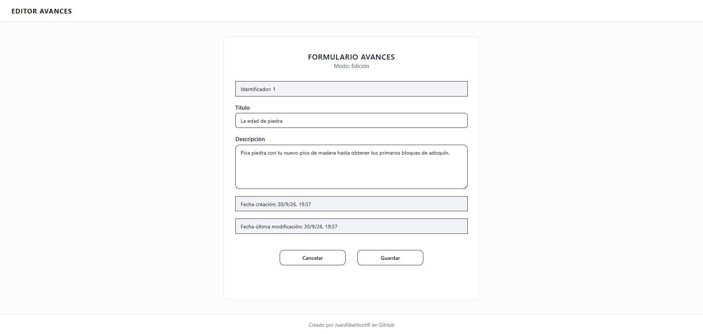

# Editor Avances

Editor de Avances Thymeleaf es una idea de proyecto de practica que consiste es un sitio web para visualizar un 
listado de avances, visualizar el contenido de un Avance y un editor de Avances.

## Objetivos de Aprendizaje

El objetivo del proyecto de practica es iniciar en la practica de Thymeleaf con un CRUD básico de Avances, visualización y gestión con Thymeleaf.

- Proyecto Monolítico: Backend con Spring Boot y Frontend con Thymeleaf.
- Persistencia SQL con MySQL.
- Ejecución en Local.

## Caracteristicas
- Página de inicio con acceso al listado de avances y la API.
- API REST con 2 endpoints: Listado de Avances y Detalle de un Avance.
- Listado de Avances con ordenación.
- Formulario para crear un nuevo Avance.
- Vista de detalle de un Avance.
- Edición y eliminación de Avances.

## Stack Tecnologico
- Lenguaje de programación: **Java 21**
- Framework: **Spring Boot 4.1.1**
- Motor de plantillas: **Thymeleaf**
- Base de datos: **MySQL**
- Control de versiones: **Git**
- Repositorio remoto: **GitHub**

## Requerimientos Previos
- Instalar [Git](https://git-scm.com/install/windows) para clonar el repositorio.
- Instalar [Docker](https://docs.docker.com/get-started/get-docker/) para el despliegue del contenedor de MySQL.

## Instalación y Ejecución

Para descargar y ejecutar el proyecto, sigue estos pasos:
### 1. Clonar el repositorio
   ```bash
   git clone https://github.com/JuanAlberticoHF/editor-avances.git
   cd editor-avances
   ```
- Esto descargará el proyecto en tu máquina local de la rama `main`, que es la rama de desarrollo actual.

### 2. Iniciar la aplicación
   ```bash
   docker-compose up -d
   ```
- La base de datos MySQL en Docker estará disponible en `localhost:3307` con el nombre `editor-avances-db`.
- Para apagar el contenedor de la base de datos utilizar el comando: `docker-compose down`.

### 3. Acceder a la aplicación
- Abre tu navegador web y navega a `http://localhost:8080` para acceder a la aplicación Editor de Avances.

## Galeria Imagenes
- Inicio aplicación:

- Listado de Avances:

- Detalle de un Avance:

- Formulario de creación de Avance:

- Formulario de edición de un Avance:
